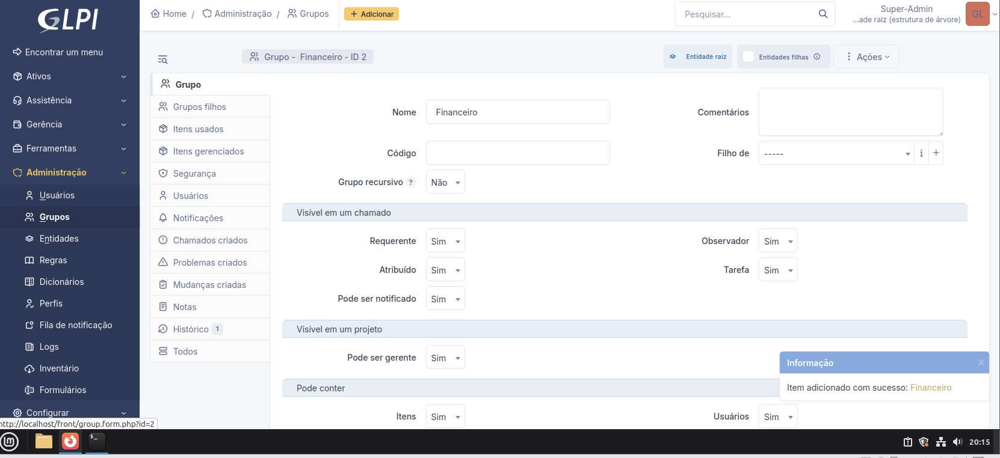
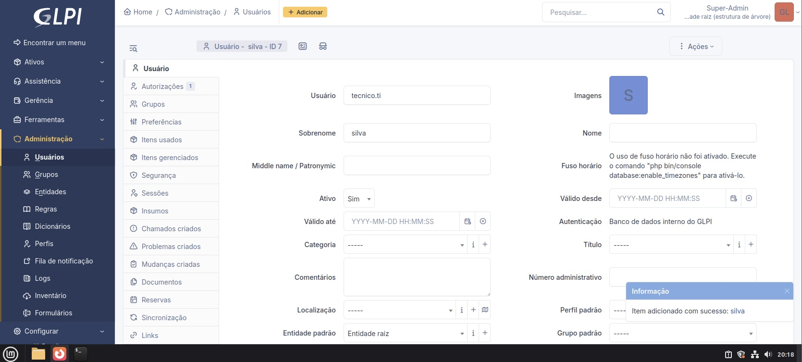
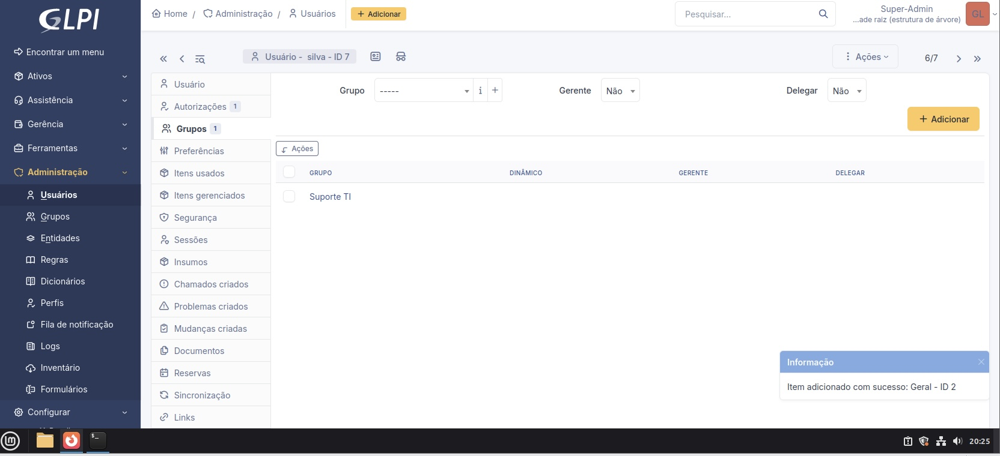
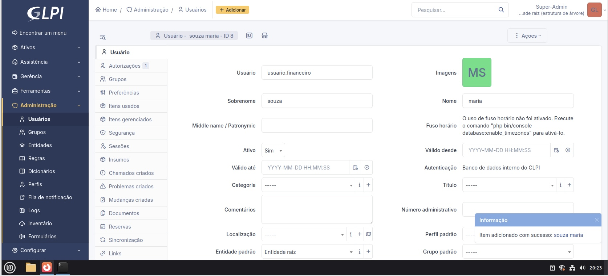
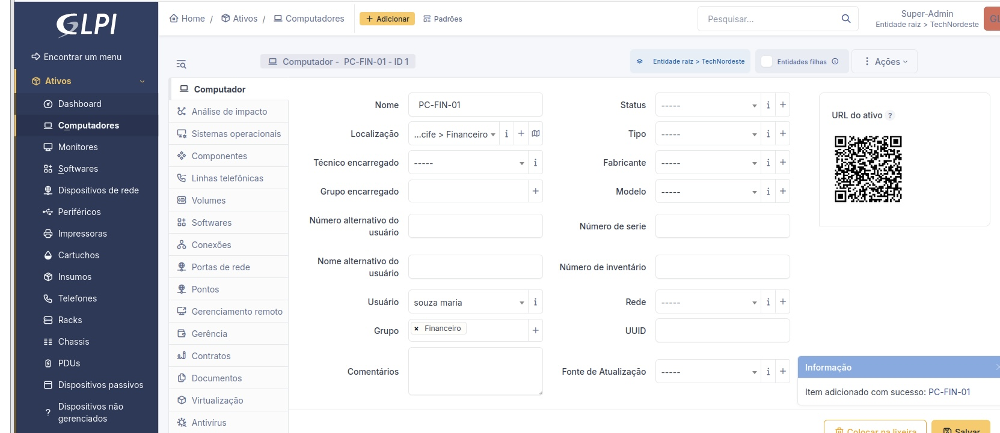
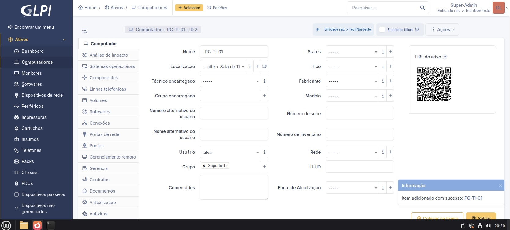
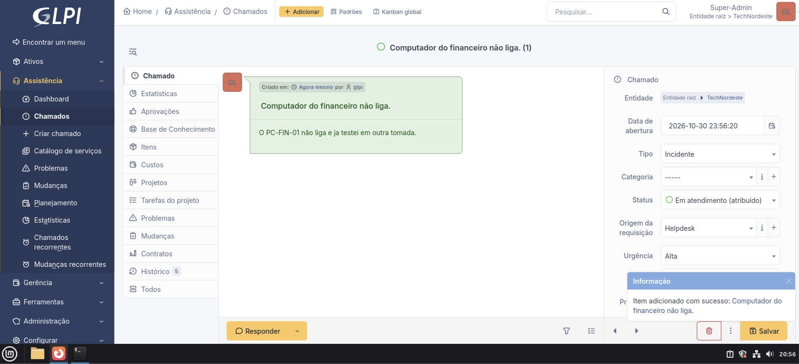
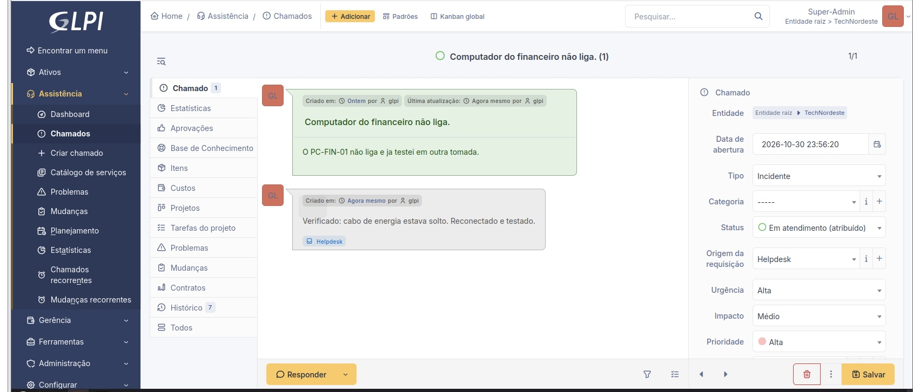
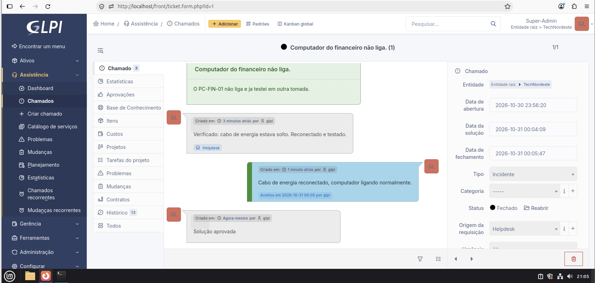
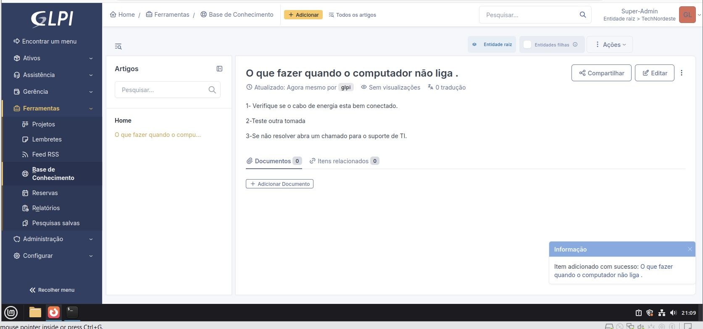

# Service Desk com GLPI

Projeto de laboratório que simula o service desk de uma empresa fictícia, a **TechNordeste**, usando o GLPI em ambiente virtualizado.

## Ambiente

- GLPI
- Linux Mint
- VMware

## O que foi feito

- Criação da entidade **TechNordeste**
- Criação das localizações: Sede - Recife, Sala de TI e Financeiro
- Criação dos grupos **Suporte TI** e **Financeiro**
- Criação de usuários e vínculo com os grupos
- Cadastro de computadores no inventário
- Abertura, solução e fechamento de um chamado
- Criação de um artigo na base de conhecimento

## Grupos

### Suporte TI

### Financeiro

## Usuários

### Usuários cadastrados

### Usuário do setor de TI

### Usuário do setor financeiro

## Inventário

### Computador do Financeiro

### Computador do TI

## Chamado

Cenário: o computador do financeiro não liga.

### Abertura do chamado

### Solução do chamado

## Base de conhecimento

Artigo criado a partir do chamado resolvido.

## Aprendizados

- Organização de entidades, grupos e usuários no GLPI
- Controle de inventário vinculado a usuários e localizações
- Ciclo completo de um chamado: abertura, solução, aprovação e fechamento
- Documentação de soluções na base de conhecimento
